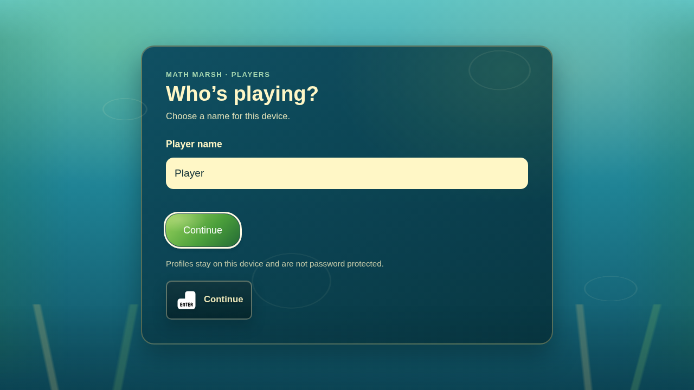
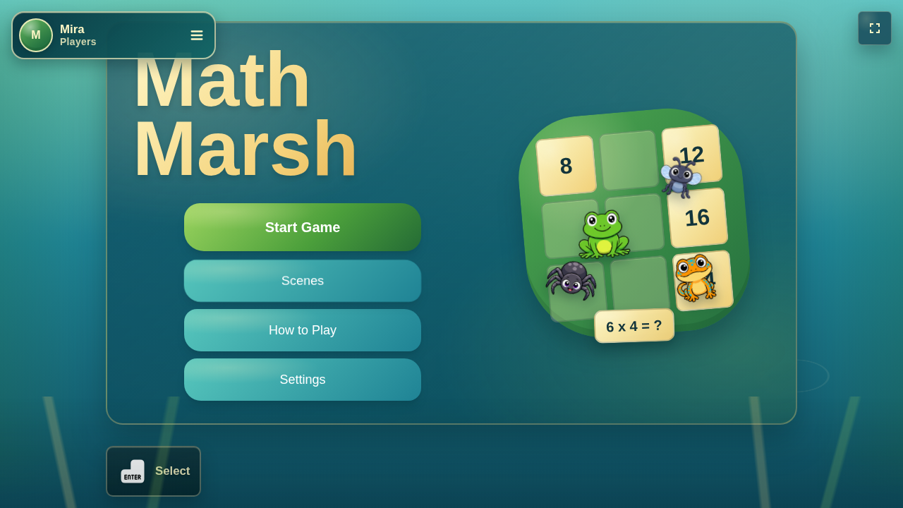
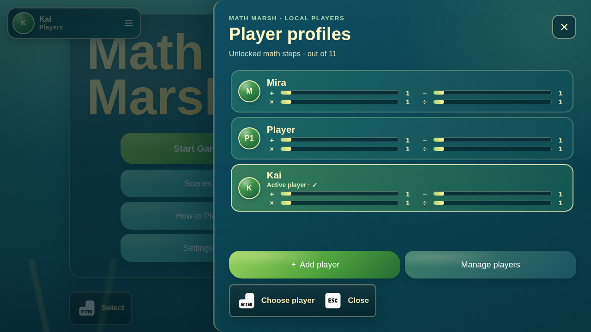
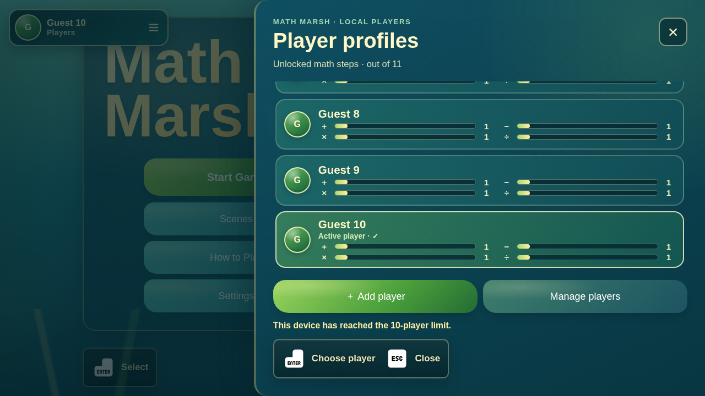
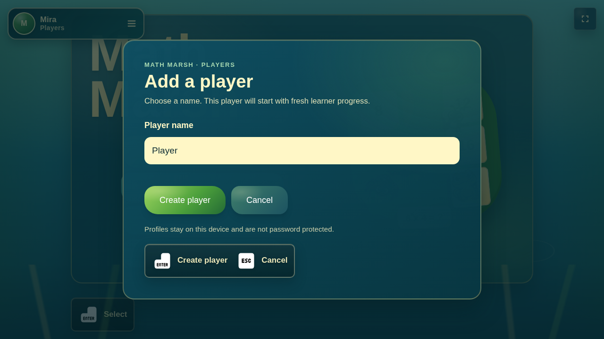
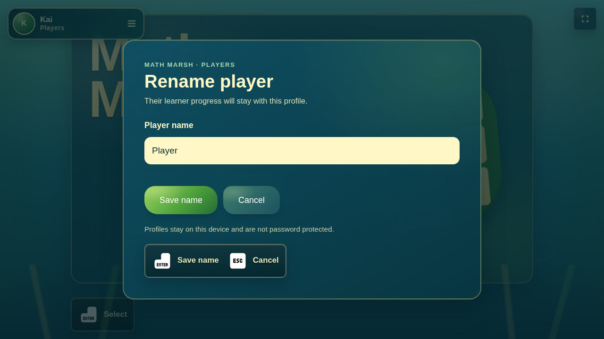
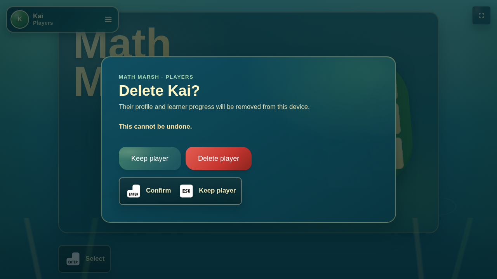

# Local player profile preview

Run `bun run dev` to explore the profile flows interactively.

The captures below show the first-use prompt, menu badge, roster, capacity limit, add, rename, and delete confirmation.

## First use

## Main-menu badge

## Roster drawer

## Ten-player limit

## Add player

## Rename player

## Delete confirmation

